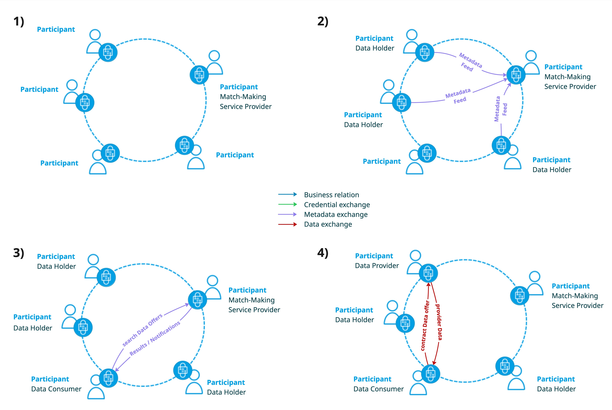
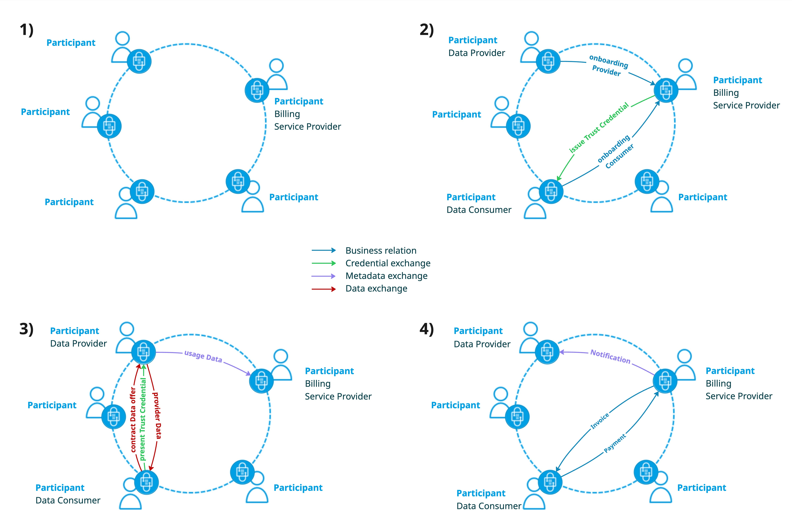

# Value-Adding Services in Decentralized Data Spaces

While decentralized data spaces fundamentally rely on autonomous participants interacting through standardized protocols such as the Dataspace Protocol (DSP) and the Decentralized Claims Protocol (DCP), many real-world ecosystems require additional value-adding services to support discovery, coordination, trust and economic processes. Rather than introducing centralized platform components, these services must be implemented in a way that preserves the core principles of decentralization, sovereignty and participant autonomy, as set out in the Rulebook's chapter on [Decentralization](https://kb.internationaldataspaces.org/external/rulebook/007_Decentralization). In this section, we describe an architectural pattern for integrating value-adding services as specialized participants within the data space itself. We use matchmaking, billing and independent determination services as concrete examples and show how they can be realized using standard data space interactions.

Each service operates under the governance rules of the [Data Space Governance Authority (DSGA)](https://kb.internationaldataspaces.org/external/rulebook/006_DSGA) and the accepted [Dataspace Trust Framework(s) (DTFs)](https://kb.internationaldataspaces.org/external/rulebook/009_Dataspace_Trust_Frameworks). Credential issuance and verification follow those DTFs and are exchanged using DCP, while contract negotiation and data exchange are governed by DSP. This keeps the services interoperable and avoids creating privileged, centralized control points.

## Matchmaking Service

A matchmaking service can be offered by one or more independent service provider organizations; a data space may have several competing matchmaking providers, and each participant individually decides which of them, if any, to use for a given negotiation. Such a service typically runs as part of the provider's own backend rather than as a mandatory, central component of the data space, consistent with the Rulebook's [Marketplaces](https://kb.internationaldataspaces.org/external/rulebook/123_Marketplaces) guidance. Data-holding participants that wish to make their assets discoverable provide structured metadata about their data offerings to a matchmaking participant of their choice, for example via event-based metadata feeds or other mechanisms such as pull-based retrieval. This metadata includes references to the corresponding DSP contract offers through which consumers can later negotiate access to the actual data. An event-driven approach allows a matchmaking service to efficiently integrate updates, additions and removals into its continuously maintained search index.

Based on the aggregated metadata, a matchmaking service builds and operates a searchable index and exposes a contract-governed search API within the data space. Any participant seeking data can establish a DSP contract with a matchmaking service of its choice to use this search interface. In addition to synchronous search, asynchronous interaction patterns can be supported: consumer participants may register data needs at a matchmaking service and are notified when matching metadata becomes available.

Search results returned to consumers contain metadata and references to the actual DSP offers of the respective data providers. As with any data space interaction, the subsequent negotiation, contracting and exchange of the actual data remain peer-to-peer between the consumer and the data-providing participants and are fully governed by DSP; the matchmaking service is not a party to that negotiation. The provision of metadata to the matchmaking service and the use of the search API are likewise governed by DSP contracts for interoperable, standardized integration.

Metadata visibility can be scoped by policy. Providers may publish public metadata, or restrict metadata feeds and search access using DSP contracts and DCP claims (e.g., membership or role-based credentials). Update and removal events are authorized by the original publisher, preserving data sovereignty while still enabling efficient discovery.

## Billing Service

A billing service can likewise be offered by one or more independent billing service provider organizations, and each participant individually decides which billing provider, if any, to use for a given exchange. Such a service typically runs as part of the provider's own backend rather than as a mandatory, central component of the data space. Both data providers and data consumers that wish to use a billing provider's infrastructure are onboarded as its customers. Onboarding establishes the roles and credentials: providers are registered and authorized to report usage for billable exchanges, while consumers receive a trust credential that verifies their eligibility to be billed through that specific billing provider.

After onboarding, a data provider may offer data under the explicit condition that consumption of the corresponding DSP contract offer is billed via a billing provider it accepts. To enforce this, the provider requires that only consumers presenting a valid billing trust credential issued by that billing provider are allowed to contract the offer. These trust credentials are issued and presented using DCP.

As with any data space interaction, the contract negotiation and the data exchange itself remain peer-to-peer between provider and consumer and are governed by DSP; presenting the billing trust credential is simply an additional proof required within that one negotiation, not a delegation of the negotiation to the billing provider. In parallel, the provider transmits usage data for all transfers to the billing service provider. The billing provider performs invoicing and payment processing directly with the consumer organization and sends operational notifications, such as payment and settlement status, back to the data provider. Trust credential exchange is governed by DCP, while usage data, notifications and contractual data exchange are consistently governed by DSP, preserving the decentralized control model.

## Independent Determination Service

An independent determination service can be offered by one or more independent service provider organizations. A participant may decide that, for a defined class of contract offers, negotiation or transfer is conditional on a current interaction-specific determination from an issuer it accepts. The service does not replace the participant's policies or make the final decision to contract or transfer. It provides a machine-verifiable claim about one proposed interaction that the participant's own control plane can consume alongside its other policy inputs.

This differs from a standing trust credential. Rather than evidencing a general status or role, the claim records that a defined rule or condition has been evaluated against the context of a particular interaction. The applicable rule can be set by the participant, by its contracts or, where a data space chooses, through the applicable governance and trust framework. Several independent issuers can coexist, and each participant remains free to decide which issuers and which claim semantics it accepts.

Before negotiation, the consumer requests a determination against a specific offer. The service evaluates the information required by the relevant rule. This can include the offer metadata and contextual facts provided by the parties, such as the parties, asset, purpose, jurisdiction or execution context. The service may determine that the condition is satisfied, not satisfied or requires referral for human determination. Only a positive determination results in a claim.

The resulting claim is bound to the specific interaction, for example by identifying the offer, parties, asset and purpose. It can also carry the applicable rule reference, a validity period and a status reference so that revocation or supersession can be checked without requiring a live call to the issuer. The claim confers no general access right and does not oblige the provider to proceed. It is a necessary input only where the provider's own policy makes it so, and all other policies continue to apply.

The claim can be presented using DCP as an additional proof during contract negotiation. The provider's control plane verifies the accepted issuer, proof, interaction binding, validity and status and records the determination reference in the agreement. Where one agreement supports several transfers, the provider can re-check status at transfer initiation for the governed class. If a required claim is absent, expired, revoked or does not match the interaction context, the governed interaction does not proceed.

The independent determination service is not a data-plane destination and does not need to receive or hold the underlying data. Contract negotiation and data exchange remain peer-to-peer between provider and consumer and are governed by DSP. The participant retains sovereignty and responsibility for final policy evaluation and enforcement.

Implementations can provide different assurance levels. A basic implementation treats the determination as a policy input to the participant's control plane. A higher-assurance implementation can bind execution technically to the presence of a current valid determination so that the governed operation cannot proceed without it. This changes the strength of enforcement, not the architectural role of the service.

The pattern introduces several governance and implementation considerations. The issuer and relying participant must share the semantics of the claim and the applicable rule; validity, status and rule versioning must address the risk of stale determinations; and the participant's policy engine must be able to match the claim's binding fields against the negotiation context. Where a fresh determination is required for every transfer, the participant is deliberately choosing an additional runtime dependency for that class of interaction.
